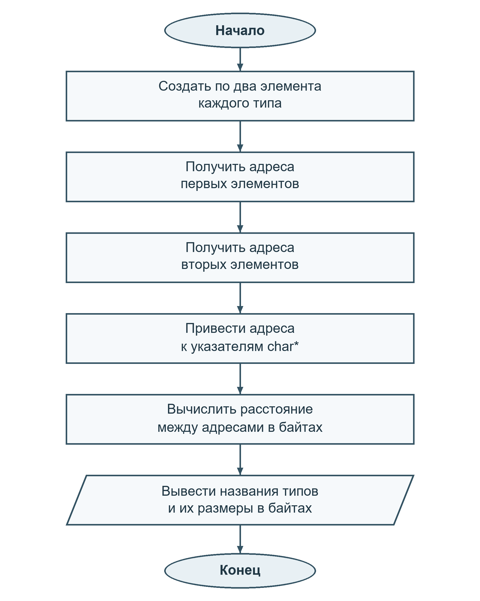

# Домашнее задание. Размеры типов данных
Определить размеры всех 11 типов, перечисленных в условии.
В программе не используются `sizeof`, `limits.h`, `float.h` и константы из них.
## Как работает программа
Для каждого типа создаётся массив из двух элементов.
Его элементы находятся в памяти подряд, поэтому расстояние между ними равно размеру одного элемента.
1. `&a` - адрес начала всего массива.
2. `&a[1]` - адрес второго элемента массива.
3. `(char*)` позволяет рассматривать адреса с шагом в один байт.
4. Разность этих адресов показывает размер одного элемента в байтах.
Например, выражение `(char*)&d[1] - (char*)&d` определяет размер `int`.
Формат `%td` используется для вывода разности указателей.
Массивы не нужно заполнять: программа использует только адреса, а не значения элементов.
`stddef.h` подключается для типов `wchar_t` и `size_t`.
Программа вычисляет эти значения, а не выводит заранее записанные размеры.
В другой системе некоторые результаты могут отличаться.
## Блок-схема

На схеме показан общий способ определения размеров, применяемый к каждому из 11 типов.
В коде вычисления записаны отдельно для каждого типа без дополнительных функций и циклов.
## Запуск
Добавьте `main.c` в консольный проект Visual Studio и запустите его.
Ввод с клавиатуры не требуется. Файл сохранён в UTF-8 с сигнатурой.
## Описание метода
